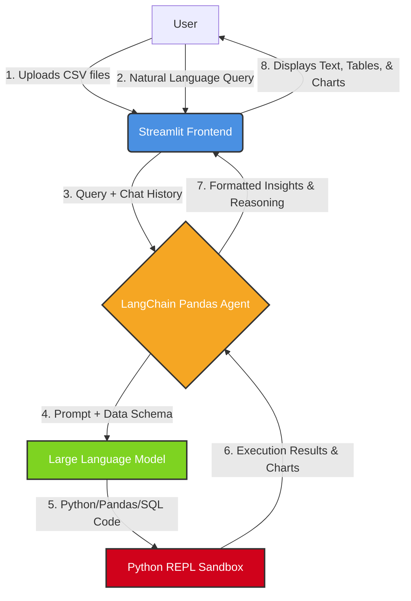

#  AI-Powered Data Analyst

An intelligent, conversational data analysis application built for the **Digital Back Office Ltd. Software Engineer Intern Assignment**. 

This application enables users to upload one or more CSV files and interact with their data using natural language. It acts as an autonomous data analyst capable of answering business questions, generating visualizations, detecting statistical anomalies, and explaining its reasoning step-by-step.

---

##  Architecture & Agentic Flow

The application leverages a LangChain Pandas DataFrame Agent combined with a Large Language Model (LLM) to dynamically write and execute Python code based on user prompts.



---

## Key Features

* **Multi-CSV Upload & Validation**: Upload one or more CSV files for seamless cross-analysis and data joining.
* **Natural Language Querying**: Ask complex business questions in plain English (e.g., *"Which region generated the highest revenue?"*).
* **Automated Visualizations**: Automatically generates Bar, Line, Pie, and Scatter charts using Matplotlib and Seaborn based on context.
* **Anomaly Detection**: Uses statistical methods to flag anomalies in the dataset and provides detailed reasoning for why they were flagged.
* **SQL & Code Generation**: Outputs the exact SQL or Pandas code used to derive the answer when requested.
* **Contextual Memory**: Maintains conversation context throughout the session for follow-up questions.

---

## Technology Stack

* **Frontend**: Streamlit
* **AI / Agent Framework**: LangChain (Experimental Pandas DataFrame Agent)
* **Data Manipulation**: Pandas
* **Visualizations**: Matplotlib, Seaborn
* **Containerization**: Docker

---

## Setup & Installation

### Option 1: Using Docker (Recommended)

1. Clone the repository:
```bash
git clone [https://github.com/yakshithkd23/ai-data-analyst.git](https://github.com/yakshithkd23/ai-data-analyst.git)
cd ai-data-analyst

```


2. Build the Docker image:
```bash
docker build -t ai-data-analyst .

```


3. Run the container:
```bash
docker run -p 8501:8501 ai-data-analyst

```


4. Open `http://localhost:8501` in your browser.

### Option 2: Local Python Environment (Ubuntu/Zorin OS)

1. Clone the repository and navigate into it.
2. Create and activate a virtual environment:
```bash
python3 -m venv venv
source venv/bin/activate

```


3. Install dependencies:
```bash
pip install -r requirements.txt

```


4. Run the application:
```bash
streamlit run app.py

```


---

## Usage Instructions

1. Launch the application in your browser.
2. Enter your **LLM API Key** in the sidebar configuration panel. *(Note: Supports OpenAI, Groq, or Google Gemini depending on the configured LLM in `app.py`)*.
3. Drag and drop your `.csv` dataset(s) into the sidebar.
4. Use the chat interface to ask questions. Try these examples:
* *"Show monthly sales trends."*
* *"What are the top five customers?"*
* *"Detect anomalies in the dataset and explain your reasoning."*
* *"Generate the SQL code for this analysis."*


---

